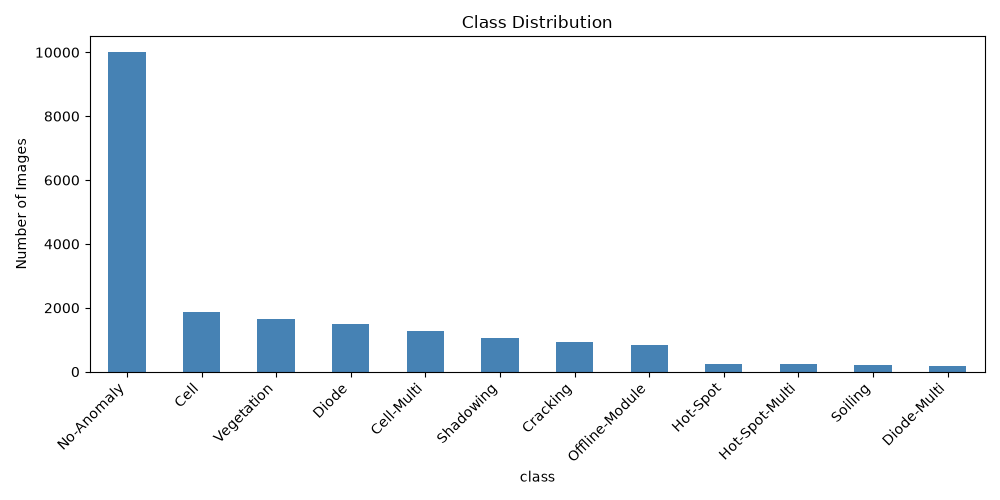
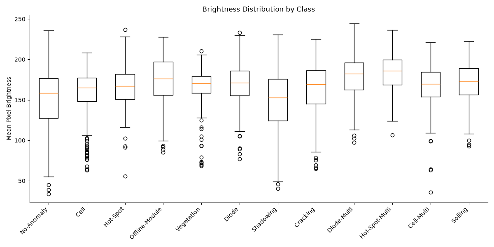
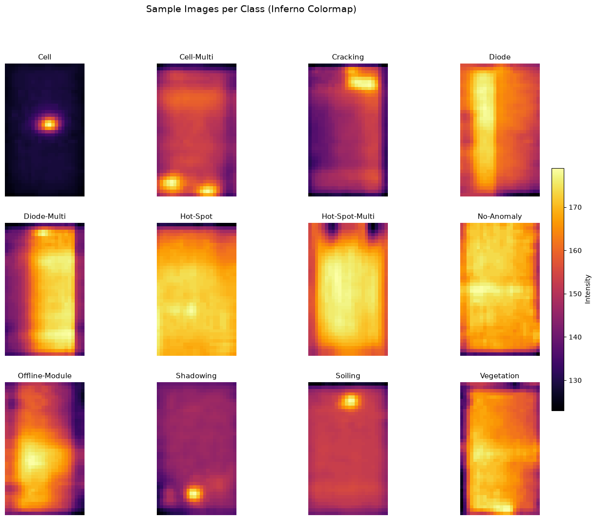
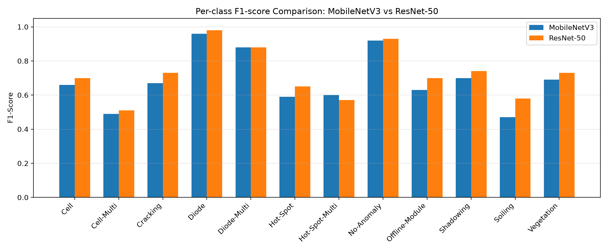

# Solar Fault Detection: MobileNetV3 vs ResNet50

Class-imbalance-aware fault classification of solar (PV) panels from infrared thermal images. This repository compares a lightweight, edge-friendly model (**MobileNetV3-Large**) with a deeper, high-capacity model (**ResNet50**) on the full **Infrared Solar Modules** dataset (20,000 images, 12 classes), using **Weighted Random Sampling** and spatial augmentation to handle severe class imbalance.

This code accompanies the paper *"Class-Imbalance-Aware for Solar Panel Fault Detection: A Comparative Analysis of MobileNetV3 and ResNet50"*.

## Highlights

- 12-class fault classification on 20,000 infrared images
- Severe long-tailed distribution: about 10,000 `No-Anomaly` images vs about 175 to 200 for the rarest classes
- Four training protocols per model (ablation) to isolate the effect of each imbalance-handling component
- Real-world deployment metrics: parameters, model size, FLOPs, CPU and GPU latency
- Statistical validation with McNemar's test

## Dataset

[Infrared Solar Modules dataset](https://github.com/RaptorMaps/InfraredSolarModules) (Millendorf, Obropta, Vadhavkar, ICLR AI for Earth Sciences Workshop, 2020).

- 20,000 infrared images, 12 classes: `Cell`, `Cell-Multi`, `Cracking`, `Diode`, `Diode-Multi`, `Hot-Spot`, `Hot-Spot-Multi`, `No-Anomaly`, `Offline-Module`, `Shadowing`, `Soiling`, `Vegetation`
- Download with `python download_dataset.py`, or manually from the link above, and extract so you have an `InfraredSolarModules/` folder in the project root.

> The dataset and trained model weights are not stored in this repo because of their size.

## Method

| Setting | Value |
|---|---|
| Input | 224 x 224, ImageNet normalization |
| Augmentation | Horizontal and vertical flips (p = 0.5), random rotation of +-15 degrees, contrast jitter of +-20% |
| Imbalance handling | Weighted Random Sampling, class weight `w_c = N / (C * N_c)`, C = 12 |
| Optimizer | AdamW (lr = 1e-4, weight decay = 1e-4) |
| Epochs | 50 |
| Framework | PyTorch |
| Test set | 2,000 held-out images |

### Ablation: four training protocols (per model)

1. **Baseline**: uniform sampling, no augmentation
2. **Augmentation only**: uniform sampling + spatial transforms
3. **WRS only**: class-weighted sampling, no augmentation
4. **Full (proposed)**: WRS + spatial augmentation

Results are in `ablation_results.csv`.

## Results

### Overall performance (2,000-image test set)

| Model | Accuracy | Macro F1 | Weighted F1 |
|---|---|---|---|
| MobileNetV3-Large | 0.81 | 0.69 | 0.80 |
| **ResNet50** | **0.83** | **0.72** | **0.83** |

McNemar's test on the paired predictions gives a statistic of 5.5518 (p = 0.0185), so the accuracy difference between the two models is statistically significant at the 0.05 level.

### Per-class F1

| Class | MobileNetV3 | ResNet50 |
|---|---|---|
| Cell | 0.66 | 0.70 |
| Cell-Multi | 0.49 | 0.51 |
| Cracking | 0.67 | 0.73 |
| Diode | 0.96 | 0.98 |
| Diode-Multi | 0.88 | 0.88 |
| Hot-Spot | 0.59 | 0.65 |
| Hot-Spot-Multi | 0.60 | 0.57 |
| No-Anomaly | 0.92 | 0.93 |
| Offline-Module | 0.63 | 0.70 |
| Shadowing | 0.70 | 0.74 |
| Soiling | 0.47 | 0.58 |
| Vegetation | 0.69 | 0.73 |

Both models do well on high-signature classes (`No-Anomaly`, `Diode`) and struggle on low-signature minority classes such as `Cell-Multi`, `Soiling` and `Hot-Spot-Multi`. The most common confusions are between thermally similar pairs: Hot-Spot / Hot-Spot-Multi, Diode / Diode-Multi, Soiling / Shadowing / Vegetation, and Cell / Cell-Multi. The infrared images are small (24 x 40 pixels), with very small temperature differences between some classes.

### Deployment metrics (input 224 x 224, batch size 1)

| Model | Params (M) | Size (MB) | FLOPs (G) | CPU latency (ms) | GPU latency (ms) | Macro F1 |
|---|---|---|---|---|---|---|
| MobileNetV3-Large | 4.2 | 16.3 | 0.23 | 64.7 | 15.1 | 0.69 |
| ResNet50 | 23.5 | 90.1 | 4.13 | 139.8 | 9.7 | 0.72 |

MobileNetV3 needs about 5.5x fewer parameters and about 18x fewer FLOPs, and is about 2x faster on CPU. ResNet50 is faster on GPU.

### Which model to use?

- **Edge devices and real-time drone inspection:** MobileNetV3, because of its small memory footprint and fast CPU inference.
- **Centralized, server-side analytics:** ResNet50, for better discrimination of rare fault types.
- In both cases, class-aware sampling is needed to avoid bias towards the majority `No-Anomaly` class.

### Plots






## Project Structure

```
solar-fault-detection/
├── download_dataset.py              # Download the dataset
├── check_dataset.py                 # Dataset sanity check
├── analyze_dataset.py               # Class distribution and brightness plots
├── create_splits.py                 # Creates train.csv / val.csv / test.csv
├── train_model.py                   # Main training script
├── retrain_resnet50.py              # ResNet50 training
├── run_ablation.py, ablationRun.py  # Ablation experiments
├── verify_saved_models.py           # Verify saved model weights
├── confusion_matrix_mobilenetv3.py  # Confusion matrix
├── plotF1Comparision.py             # F1 comparison plot
├── statistical_test.py, McnemarTest.py  # McNemar's test
├── model_efficiency.py              # Params, size, FLOPs, latency
├── train.csv, val.csv, test.csv     # Data splits
└── *.csv, *.png                     # Results and plots
```

## Setup

```bash
git clone https://github.com/Pragyaa-pg/solar-fault-detection.git
cd solar-fault-detection

python -m venv venv
venv\Scripts\activate          # Windows
# source venv/bin/activate     # Linux / Mac

pip install -r requirements.txt
```

## How to Run

```bash
python download_dataset.py
python analyze_dataset.py
python create_splits.py
python train_model.py
python retrain_resnet50.py
python run_ablation.py
python confusion_matrix_mobilenetv3.py
python statistical_test.py
python McnemarTest.py
python model_efficiency.py
python plotF1Comparision.py
```

A GPU is recommended. Scripts fall back to CPU if CUDA is not available.

## Tech Stack

Python, PyTorch, torchvision, scikit-learn, pandas, NumPy, Pillow, Matplotlib

## Authors

Gayatri Rajpoot, Pragya Gupta, Ananya Rao, Kratika, Jahanvi Katiyar

- Pragya Gupta: [GitHub @Pragyaa-pg](https://github.com/Pragyaa-pg) | [LinkedIn](https://linkedin.com/in/pragya-4568aa376)

## Acknowledgements

- Dataset: Millendorf, M., Obropta, E., Vadhavkar, N., *Infrared Solar Module Dataset for Anomaly Detection*, ICLR AI for Earth Sciences Workshop, 2020.
